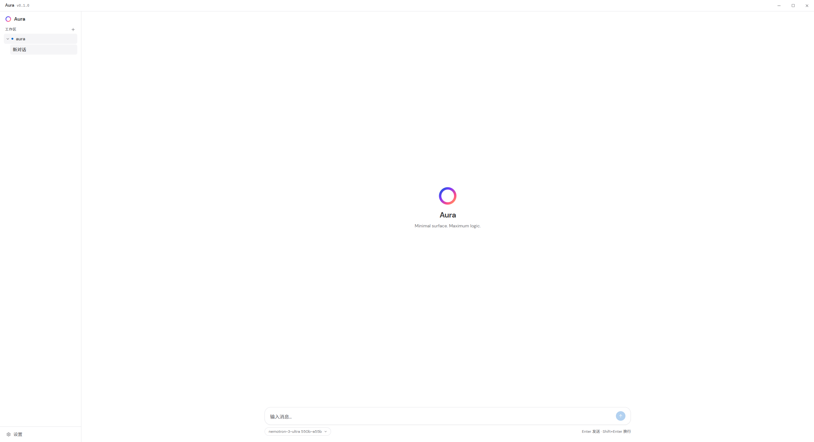
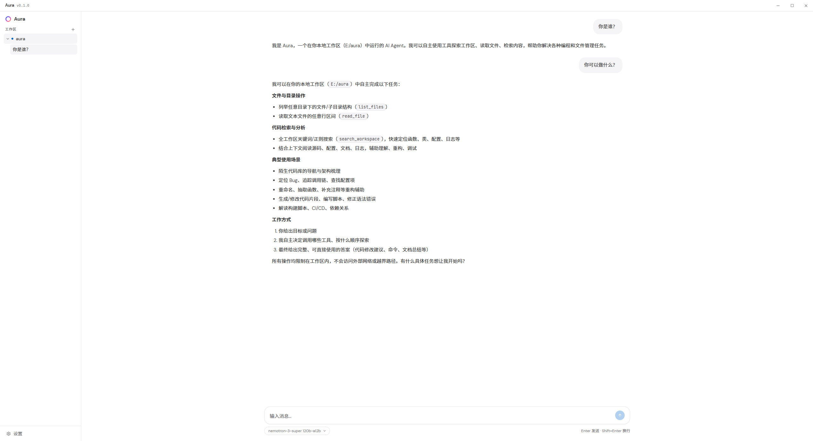
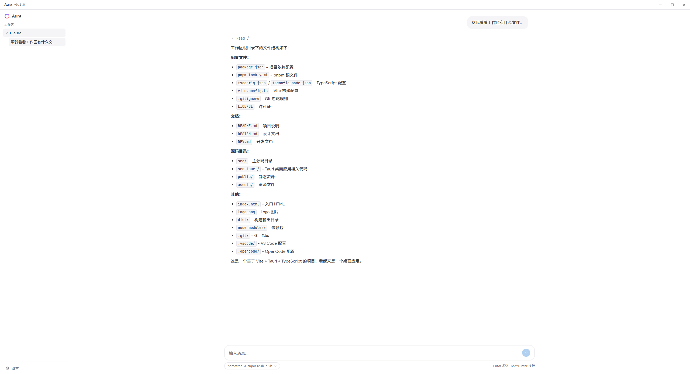
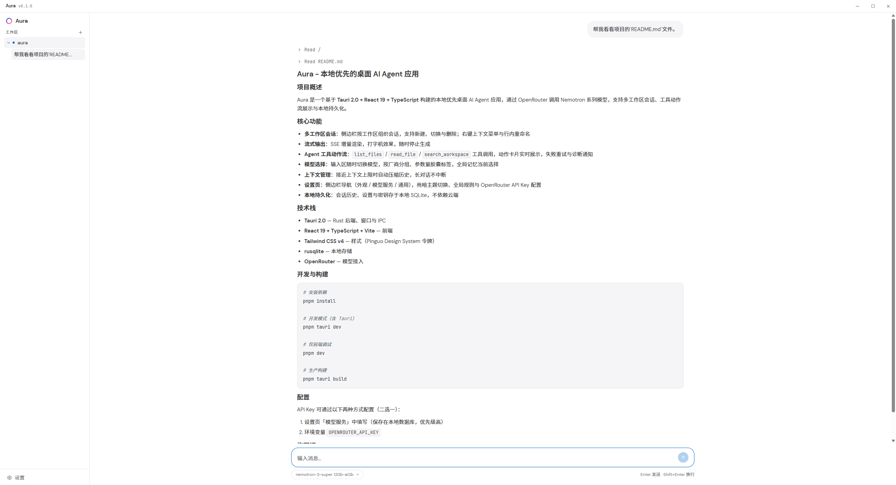

<p align="center">
  
</p>

<h1 align="center">Aura</h1>

<p align="center">
  
  
  
  
</p>

本地优先的桌面 AI Agent 应用，基于 Tauri 2.0 + React 19 + TypeScript 构建。支持接入多家云端模型厂商与本地推理框架，会话、密钥与配置全部存于本机。

## 功能

- **多厂商接入**：内置 17 家厂商预设（OpenRouter、OpenAI、DeepSeek、月之暗面 Kimi、智谱 GLM、MiniMax、硅基流动、零一万物、百川、阶跃星辰、Groq、xAI、Together、阿里百炼、火山方舟、腾讯混元，以及自定义 OpenAI 兼容端点），选择厂商后自动填入官方接口地址
- **本地模型**：支持 Ollama 与 llama.cpp server，可在应用内探测服务状态、拉取模型并查看下载进度
- **模型目录与收藏**：选择厂商后一键获取该厂商全部可用模型，搜索并勾选收藏；已收藏模型按厂商分组平铺，对话页可随时切换
- **三种工作模式**：对话、规划、执行，输入框下方标签切换，每次发送时按当前所选模式生效
- **任务清单**：规划模式产出可执行步骤并在侧边栏展示，执行模式逐步推进并实时更新状态
- **多工作区会话**：侧边栏按工作区组织会话，支持新建、切换与删除；右键上下文菜单与行内重命名（操作不触碰磁盘文件）
- **自动降级**：主模型限流或故障时按降级链自动切换下一个可用模型，并提示降级原因
- **流式输出**：SSE 增量渲染，打字机效果，随时停止生成
- **完整工具集**：`list_files` / `read_file` / `search_workspace` 读取检索，`write_file` / `string_replace` / `replace_lines` 修改文件，`run_script` 执行命令；动作卡片实时展示，失败重试与诊断通知
- **上下文管理**：接近上下文上限时自动压缩历史，长对话不中断；任务清单独立保存，不随压缩丢失
- **设置页**：侧边栏可收起展开；设置分区涵盖外观、模型服务与通用项，支持亮暗主题切换与全局规则配置
- **本地持久化**：会话历史、任务清单、设置与密钥存于本地 SQLite，不依赖云端

## 工作模式

输入框下方的标签选择模式，**每次发送时按当前所选模式生效，随时可改**。三种模式的区别在于允许的操作范围与提示词侧重：

| 模式 | 定位 | 可读文件 | 可改文件 | 可执行命令 | 侧重 |
| --- | --- | :---: | :---: | :---: | --- |
| 对话 | 纯问答 | ✓ | — | — | 直接回答，不涉及流程 |
| 规划 | 产出计划 | ✓ | — | — | 先调研现状，再给出可执行步骤 |
| 执行 | 动手做事 | ✓ | ✓ | ✓ | 按任务清单逐步推进并更新进度 |

权限由程序强制校验：即使模型在对话或规划模式下尝试调用写入类工具，也会被拦截并提示切换到执行模式，而非静默失败。

任务清单在全部步骤完成后自动清空，清单随会话保存，重启后自动恢复。

> **行为变更提醒**
>
> - 从 v0.5.0 起：对话模式由全权限改为只读。升级后若希望 Aura 直接修改文件，请将模式切换到「执行」。
> - 从 v0.5.1 起：修复了执行输出较多的命令（如安装依赖、编译项目）时界面长时间无响应的问题。
> - 从 v0.5.2 起：长对话中的流式输出更加流畅，历史消息不再被反复重新渲染。

## 内置厂商

| 类别 | 厂商 |
| --- | --- |
| 国际 | OpenRouter、OpenAI、DeepSeek、月之暗面 Kimi、Groq、xAI Grok、Together AI |
| 国内 | 智谱 GLM、硅基流动 SiliconFlow、零一万物 Yi、百川智能、阶跃星辰 Step、MiniMax 稀宇、阿里百炼通义千问、火山方舟豆包、腾讯混元 |
| 本地 | Ollama、llama.cpp server |
| 其他 | Azure OpenAI、自定义 OpenAI 兼容端点（可附加自定义请求头） |

所有云端厂商均通过 OpenAI 兼容协议接入，DeepSeek、智谱 GLM、火山方舟等非 `/v1` 路径的端点规则已内置处理。

## 截图

### 欢迎页



### 基础对话



### 工具调用





## 开发

```bash
pnpm install
pnpm tauri dev
```

前端单独调试：

```bash
pnpm dev
```

## 构建

```bash
pnpm tauri build
```

## 配置

在设置页「模型服务」中配置，每个厂商一张独立卡片：

1. 选择模型厂商（自动填入官方接口地址）
2. 填写该厂商的 API Key
3. 点击「获取模型列表」拉取可用模型，搜索并勾选需要收藏的模型

密钥仅保存在本地 SQLite 数据库中，不会上传到任何第三方服务。

本地模型（Ollama / llama.cpp）无需 API Key，只需保证本地服务已启动。

> **关于环境变量**：`OPENROUTER_API_KEY` 仅作为 OpenRouter 的历史兼容兜底保留；其他厂商请在设置页填写密钥。

## 技术栈

- [Tauri 2.0](https://tauri.app) — Rust 后端、窗口与 IPC
- React 19 + TypeScript + Vite — 前端
- Tailwind CSS v4 — 样式（Pinguo Design System 令牌）
- rusqlite — 本地存储
- reqwest — 多厂商 HTTP 接入

## 许可证

本项目基于 [Apache License 2.0](LICENSE) 开源。